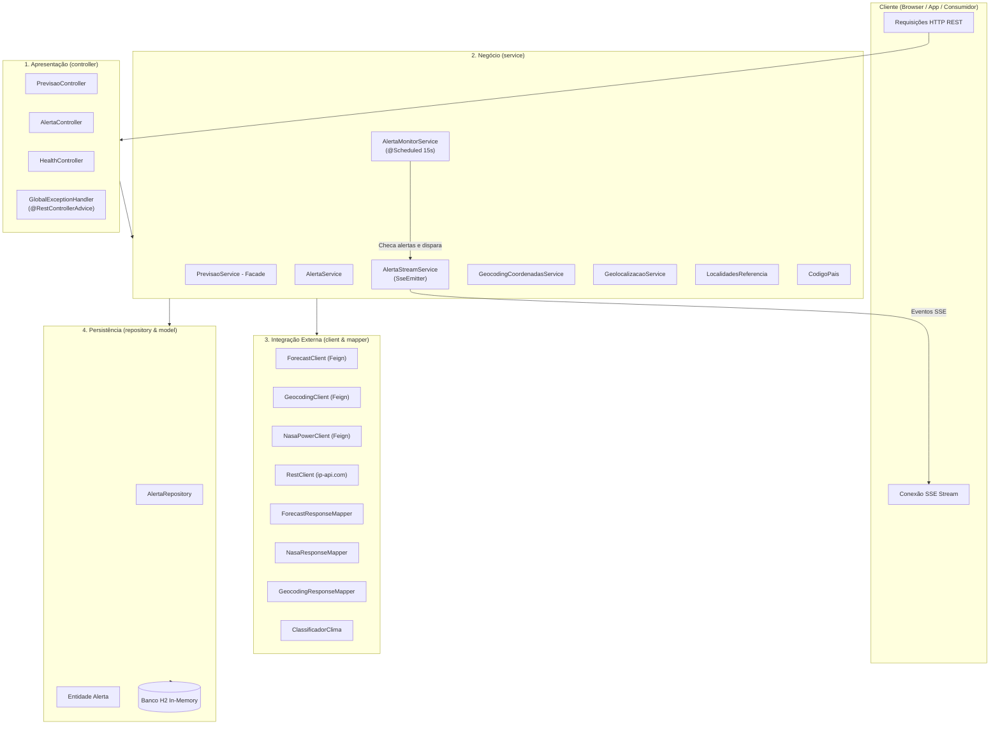

# Weather API - Guia do Projeto e Instruções para Agentes (GEMINI.md)

Este documento descreve a arquitetura, stack tecnológica, padrões de desenvolvimento e instruções operacionais da **Weather API**. Serve como contexto principal para agentes de IA e desenvolvedores que atuam no repositório.

---

## 1. Visão Geral do Projeto

A **Weather API** é uma aplicação backend desenvolvida pelo IFSC (Instituto Federal de Santa Catarina) cujo objetivo é unificar e abstrair o consumo de múltiplos provedores de dados meteorológicos e de geolocalização. Independentemente do provedor consultado (histórico ou previsão futura), a API entrega as respostas em um formato padronizado e consistente.

Além disso, a API oferece um sistema de **monitoramento e alertas climáticos em tempo real via Server-Sent Events (SSE)**, notificando clientes caso condições meteorológicas (temperatura máxima, mínima ou precipitação) atinjam os limites configurados.

### Provedores Externos Integrados

| Provedor | Função | Cliente Feign / HTTP |
|---|---|---|
| **Open-Meteo Geocoding** | Converte nomes de cidades/países em coordenadas geográficas (lat, lon) | `GeocodingClient` |
| **Open-Meteo Forecast** | Previsão climática diária de hoje até os próximos 15 dias | `ForecastClient` |
| **NASA POWER API** | Dados meteorológicos históricos (datas anteriores a hoje) | `NasaPowerClient` |
| **ip-api.com** | Geolocalização reversa a partir do endereço IP da requisição | `GeolocalizacaoService` via `RestClient` |

---

## 2. Stack Tecnológica e Requisitos de Ambiente

- **Linguagem**: Java 25 (utiliza toolchain Java 25 no Gradle).
- **Framework Principal**: Spring Boot 4.1.0 (`spring-boot-starter-webmvc`, `spring-boot-starter-data-jpa`, `spring-boot-starter-validation`).
- **Gerenciador de Dependências e Build**: Gradle 9.5.1 (wrapper `./gradlew`).
- **Comunicação HTTP Declarativa**: Spring Cloud OpenFeign 2025.1.2.
- **Banco de Dados**: H2 Database (em memória, modo `create-drop` para desenvolvimento e testes).
- **Documentação de API**: Springdoc OpenAPI UI 2.8.9 (Swagger UI em `/docs`, OpenAPI JSON em `/docs-json`).
- **Testes**: JUnit 5, Mockito, Spring Boot Test, Spring WebMvc Test.
- **Notificação em Tempo Real**: Spring Web MVC `SseEmitter` (Server-Sent Events) acoplado a `@Scheduled` (15 segundos).

---

## 3. Arquitetura e Padrões de Projeto

O projeto segue estritamente uma **Arquitetura em Camadas (Layered Architecture)** com desacoplamento de responsabilidades e injeção de dependências:



### Padrões Arquiteturais Adotados

1. **Facade Pattern (`PrevisaoService`)**:
   Encapsula a complexidade de resolver coordenadas via geocoding, rotear entre APIs externa de histórico (NASA) ou previsão (Open-Meteo), e normalizar a saída em um único objeto de domínio (`DadosClimaticos`).
2. **Strategy / Conditional Routing**:
   No método `PrevisaoService.buscarClima()`, se a data solicitada for anterior a hoje, consulta a NASA POWER; se for de hoje em diante, consulta a Open-Meteo Forecast.
3. **Observer / Pub-Sub (`AlertaStreamService` & `AlertaMonitorService`)**:
   Clientes se registram em canais SSE (`/alertas/stream?canalId=...`). O scheduler (`AlertaMonitorService`) verifica os alertas ativos periodicamente e publica os eventos nos canais registrados.
4. **Data Transfer Object (DTO) & Envelope Pattern**:
   Nenhuma entidade de banco é exposta diretamente. Todas as respostas da API usam o envelope padronizado `ApiResponse<T>`:
   ```json
   {
     "status": 200,
     "success": true,
     "title": "OK",
     "data": { ... }
   }
   ```
5. **Declarative REST Clients (Spring Cloud OpenFeign)**:
   Integração simplificada com Open-Meteo e NASA via interfaces anotadas com `@FeignClient`.

---

## 4. Estrutura do Código-Fonte (`src/main/java/ifsc/edu/lll`)

```text
src/main/java/ifsc/edu/lll/
├── LllApplication.java          # Ponto de entrada Spring Boot (@EnableFeignClients, @EnableScheduling)
├── client/                     # Interfaces Feign para serviços externos
│   ├── ForecastClient.java
│   ├── GeocodingClient.java
│   └── NasaPowerClient.java
├── config/                     # Configurações gerais (OpenApiConfig)
│   └── OpenApiConfig.java
├── controller/                 # Endpoints REST e anotações Swagger
│   ├── AlertaController.java
│   ├── HealthController.java
│   └── PrevisaoController.java
├── dto/                        # DTOs organizados por contexto
│   ├── alerta/                 # DTOs de alertas (Request, Response, Disparo)
│   ├── forecast/               # DTOs de resposta do Open-Meteo Forecast
│   ├── geocoding/              # DTOs de geocodificação
│   ├── nasa/                   # DTOs de resposta do NASA POWER
│   ├── response/               # ApiResponse (envelope padrão) e IpApiResponse
│   └── shared/                 # Coordenadas, DadosClimaticos
├── exception/                  # Tratamento centralizado de erros
│   └── GlobalExceptionHandler.java
├── model/                      # Entidades de domínio JPA
│   └── Alerta.java
├── repository/                 # Repositórios Spring Data JPA
│   └── AlertaRepository.java
└── service/                    # Regras de negócio e orquestração
    ├── AlertaMonitorService.java
    ├── AlertaService.java
    ├── AlertaStreamService.java
    ├── CodigoPais.java
    ├── ForecastClimaService.java
    ├── GeocodingCoordenadasService.java
    ├── GeolocalizacaoService.java
    ├── LocalidadesReferencia.java
    ├── NasaClimaService.java
    ├── PrevisaoService.java
    └── mapper/                 # Conversores entre DTOs de provedores e DadosClimaticos
        ├── ClassificadorClima.java
        ├── ForecastResponseMapper.java
        ├── GeocodingResponseMapper.java
        └── NasaResponseMapper.java
```

---

## 5. Endpoints REST da API

### Previsão (`/previsao`)
- `GET /previsao/{pais}`: Previsão para as capitais/cidades de referência do país.
- `GET /previsao/{pais}/{estado}`: Previsão para as cidades de referência do estado.
- `GET /previsao/{pais}/{estado}/{cidade}`: Previsão meteorológica para a cidade especificada.
- `GET /previsao/aqui`: Previsão baseada no endereço IP do cliente (geolocalizado via `ip-api.com`).
  * *Parâmetro opcional comum*: `?data=yyyy-MM-dd` (se omitido, usa a data atual).

### Alertas e Notificações (`/alertas`)
- `POST /alertas`: Cadastra uma condição de alerta (canalId, país, cidade, limites de temperatura/chuva).
- `GET /alertas`: Lista todos os alertas cadastrados.
- `GET /alertas/stream?canalId={id}`: Abre conexão SSE (`text/event-stream`) para receber os disparos de alerta.

### Monitoramento (`/ping`)
- `GET /ping`: Health check que retorna `{ "status": 200, "success": true, "title": "OK", "data": "pong" }`.

---

## 6. Instruções de Construção, Testes e Execução

### Comandos Gradle

```bash
# Executar todos os testes unitários e de integração
./gradlew test

# Executar uma classe de teste específica
./gradlew test --tests "ifsc.edu.lll.service.PrevisaoServiceTest"

# Iniciar a aplicação localmente (porta padrão: 8080)
./gradlew bootRun

# Compilar o projeto e gerar o pacote JAR
./gradlew build -x test
```

### Portas e URLs de Desenvolvimento
- Aplicação: `http://localhost:8080`
- Swagger UI / Documentação Interativa: `http://localhost:8080/docs`
- OpenAPI JSON: `http://localhost:8080/docs-json`
- H2 Console: `http://localhost:8080/h2-console` (JDBC URL: `jdbc:h2:mem:weatherdb`, Usuário: `sa`, Senha: vazia)

---

## 7. Diretrizes e Convenções para Agentes e Desenvolvedores

1. **Injeção de Dependências**:
   - Sempre utilize injeção via construtor.
   - **Nunca** use `@Autowired` em campos (`field injection`).
2. **DTOs e Imutabilidade**:
   - Use `record` do Java para representar DTOs.
   - Entidades JPA (`model`) nunca devem ser retornadas diretamente nos Controllers.
3. **Padronização de Respostas HTTP**:
   - Toda rota deve retornar `ResponseEntity<ApiResponse<T>>`.
   - Utilize métodos estáticos como `ApiResponse.success(data)` ou `ApiResponse.error(status, title, data)`.
4. **Tratamento de Exceções**:
   - Nunca capture e ignore exceções sem log adequado.
   - Qualquer nova exceção de negócio deve ser tratada no `GlobalExceptionHandler`.
5. **Documentação com OpenAPI**:
   - Mantenha controllers anotados com `@Tag`, `@Operation`, `@Parameter` e `@ApiResponses`.
   - Garanta que schemas de retorno estejam explicitados.

---

## 8. Estado Atual e Próxima Entrega (`specs/implementacao_autorizacao.md`)

O repositório encontra-se na branch `feat/autorizacao`.
Existe uma especificação formal EARS já redigida em `specs/implementacao_autorizacao.md` para introduzir:
- Autenticação e autorização via JWT (`spring-boot-starter-security` + `jjwt 0.12.6`).
- Entidade `Cliente`, rotas `/auth/clientes` e `/auth/login`.
- Proteção das rotas de alertas (`POST /alertas`, `GET /alertas`) e SSE (`/alertas/stream`).
- Chave composta para canais SSE: `(clienteId, canalId)`.
- Requisito de variável de ambiente `JWT_SECRET` (mínimo 32 bytes) para inicialização da API.

Consulte a skill `.agents/skills/implementar-autorizacao/SKILL.md` para instruções de execução dessa funcionalidade.
