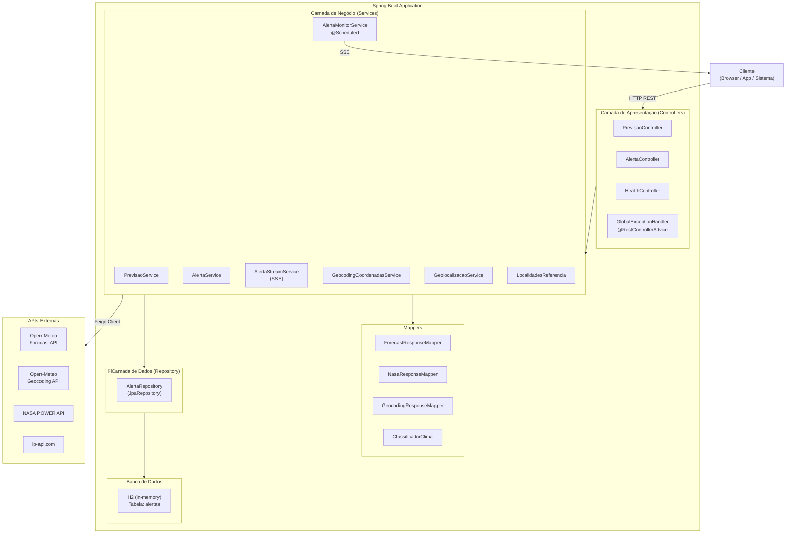
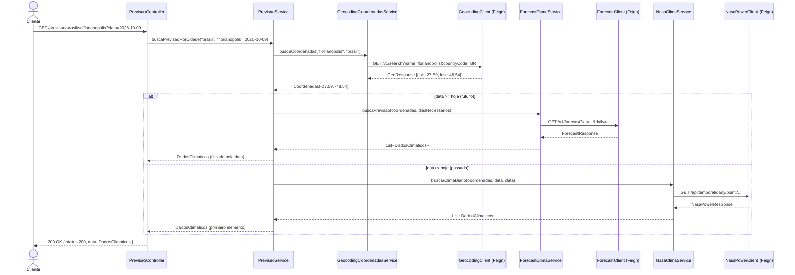
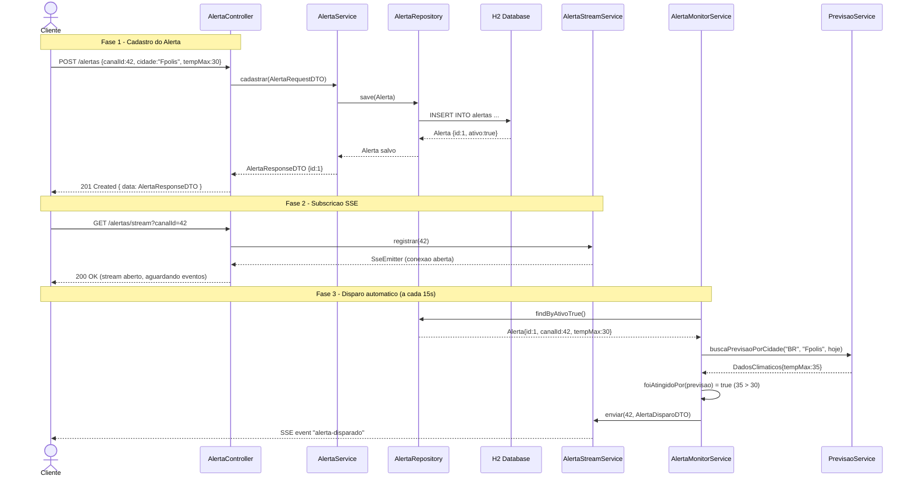
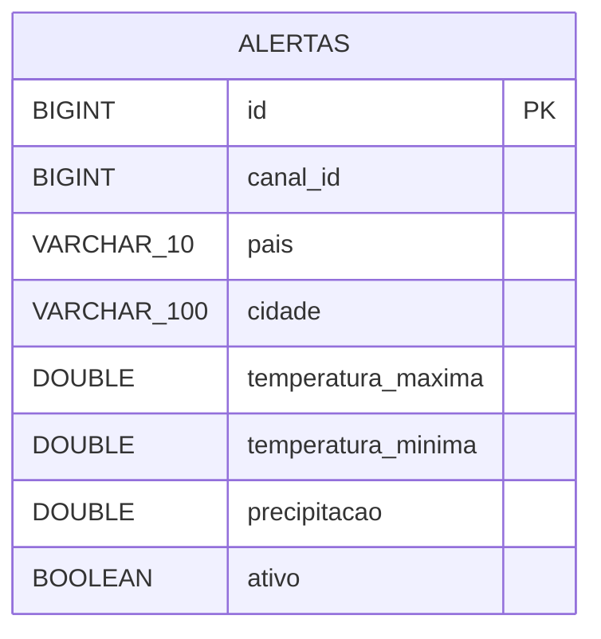

# Weather Api

API de clima que junta vários provedores e devolve sempre a mesma resposta.

## Sumário

1. [Objetivo e público alvo](#objetivo-e-público-alvo)
2. [Requisitos](#requisitos)
3. [Casos de uso](#casos-de-uso)
4. [Especificação da API](#especificação-da-api)
5. [Arquitetura](#arquitetura)
6. [Modelo de software (UML)](#modelo-de-software-uml)
7. [Modelo de dados (ER)](#modelo-de-dados-er)
8. [Testes](#testes)
9. [Manual de implantação e utilização](#manual-de-implantação-e-utilização)
10. [Uso de IA](#uso-de-ia)
11. [Integrantes](#integrantes)

## Objetivo e público alvo

Cada provedor de clima traz informações em um formato diferente e isso confunde quem consome. A Weather Api esconde essa complexidade. O cliente chama a nossa API e recebe sempre a mesma resposta, não importa de qual provedor veio o dado.

Público alvo: cidadãos, desenvolvedores e empresas que precisam de dados de clima em uma fonte só.

Provedores usados:

| Provedor | Para que serve |
|---|---|
| Open-Meteo Geocoding | Nome da cidade vira coordenada |
| Open-Meteo Forecast | Previsão de hoje até os próximos 15 dias |
| NASA POWER | Dados de datas passadas |
| ip-api.com | Descobre a cidade pelo IP |

Stack: Java 25, Spring Boot 4.1.0, Gradle, Feign Client, Spring Data JPA com Hibernate, H2, springdoc (Swagger), JUnit 5, Mockito e MockMvc.

## Requisitos

Funcionais:

- Consultar previsão por país, por estado e por cidade
- Consultar previsão pelo IP do cliente
- Cadastrar alertas de clima e receber avisos em tempo real
- Verificar se a API está no ar

Não funcionais:

- Consistência: toda resposta segue o mesmo formato JSON, independente do provedor
- Portabilidade: rodar com Java 25 e Spring Boot
- Testabilidade: ter testes de unidade e de integração
- Documentação: API documentada com OpenAPI

Planejado para depois: planejamento de viagem, cache das respostas e aviso por email.

## Casos de uso

Atores:

| Ator | Descrição |
|---|---|
| Usuário Final | Pessoa que consulta previsão do tempo |
| Sistema Cliente | Aplicação que consome a API e assina alertas |
| Scheduler Interno | Job agendado do Spring que monitora alertas |

| Código | Caso de uso | Ator | Endpoint |
|---|---|---|---|
| UC-01 | Consultar previsão por país | Usuário Final | GET /previsao/{pais} |
| UC-02 | Consultar previsão por estado | Usuário Final | GET /previsao/{pais}/{estado} |
| UC-03 | Consultar previsão por cidade | Usuário Final | GET /previsao/{pais}/{estado}/{cidade} |
| UC-04 | Consultar previsão pela localização do IP | Usuário Final | GET /previsao/aqui |
| UC-05 | Cadastrar alerta de clima | Sistema Cliente | POST /alertas |
| UC-06 | Assinar stream de alertas | Sistema Cliente | GET /alertas/stream?canalId= |
| UC-07 | Monitoramento automático de alertas | Scheduler Interno | interno |
| UC-08 | Verificar se a API está no ar | Sistema de monitoramento | GET /ping |

UC-05, passo a passo: o cliente envia canalId, país, cidade e pelo menos um limite. O sistema valida os campos, salva o alerta no H2 com ativo igual a true e devolve o alerta criado com 201 Created.

UC-06, passo a passo: o cliente abre uma conexão SSE informando o canalId. A conexão fica aberta e o sistema envia um evento alerta-disparado sempre que a condição do alerta for atingida.

UC-07, passo a passo: o Spring Scheduler roda a cada 15 segundos, busca todos os alertas ativos, consulta a previsão de cada cidade e dispara o evento SSE no canal quando a condição for atingida.

## Especificação da API

A documentação completa e interativa fica no Swagger:

- Swagger UI: http://localhost:8080/swagger-ui/index.html
- JSON OpenAPI: http://localhost:8080/v3/api-docs

Toda resposta usa o mesmo envelope:

```json
{
  "status": 200,
  "success": true,
  "title": "OK",
  "data": {}
}
```

Endpoints:

| Método | Rota | O que faz |
|---|---|---|
| GET | /previsao/{pais} | Clima das cidades de referência do país |
| GET | /previsao/{pais}/{estado} | Clima das cidades de referência do estado |
| GET | /previsao/{pais}/{estado}/{cidade} | Clima de uma cidade |
| GET | /previsao/aqui | Clima pela localização do IP |
| POST | /alertas | Cadastra alerta |
| GET | /alertas | Lista alertas ativos |
| GET | /alertas/stream?canalId= | Abre stream SSE de alertas |
| GET | /ping | Health check |

As rotas de previsão aceitam o parâmetro opcional `data` no formato yyyy-MM-dd. Sem ele, usa o dia de hoje.

Exemplo de alerta:

```json
POST /alertas
{
  "canalId": 42,
  "pais": "Brasil",
  "cidade": "Florianópolis",
  "temperaturaMaxima": 35.0,
  "precipitacao": 20.0
}
```

Erros:

| Código | Quando acontece |
|---|---|
| 400 | Corpo ausente, JSON quebrado ou data fora do formato yyyy-MM-dd |
| 404 | Cidade não encontrada ou previsão fora da janela do provedor |
| 422 | Dados inválidos, como campo vazio |
| 500 | Erro interno |

## Arquitetura

O projeto usa arquitetura em camadas. Cada camada só conversa com a de baixo.



Pastas em `src/main/java/ifsc/edu/lll`:

| Pasta | Função |
|---|---|
| controller | Recebe as requisições e documenta no Swagger |
| service | Regras de negócio |
| client | Interfaces Feign que chamam os provedores |
| mapper | Converte a resposta de cada provedor para o nosso formato |
| repository | Acesso ao banco com Spring Data JPA |
| model | Entidades do banco |
| dto | Objetos de entrada e saída |
| exception | Tratamento global de erros |
| config | Configuração do OpenAPI |

Padrões arquiteturais adotados:

| Padrão | Aplicação |
|---|---|
| Layered Architecture | Separação em Controller, Service e Repository |
| DTO Pattern | Evita exposição das entidades JPA |
| Facade | O PrevisaoService oculta a complexidade dos múltiplos provedores |
| Strategy | O método buscarClima escolhe o provedor pela data |
| Observer | O AlertaStreamService notifica os clientes via SSE |
| Repository Pattern | O AlertaRepository abstrai o acesso ao banco |

Decisões importantes:

- Facade: o `PrevisaoService` decide se usa NASA em datas passadas ou Open-Meteo de hoje em diante
- DTO: o formato `DadosClimaticos` é igual para todos os provedores
- O `GlobalExceptionHandler` transforma erros em respostas padronizadas
- Os alertas são checados a cada 15 segundos com `@Scheduled` e enviados por SSE

## Modelo de software (UML)

### Diagrama de classes

```mermaid
classDiagram
    class PrevisaoController {
        -PrevisaoService previsaoService
        -GeolocalizacaoService geolocalizacaoService
        +previsaoPorPais(pais, data) ResponseEntity
        +previsaoPorPaisEstado(pais, estado, data) ResponseEntity
        +previsaoPorPaisEstadoCidade(pais, estado, cidade, data) ResponseEntity
        +meuLocal(request) ResponseEntity
    }

    class AlertaController {
        -AlertaService alertaService
        -AlertaStreamService stream
        +cadastrar(dto) ResponseEntity
        +listar() ResponseEntity
        +assinar(canalId) SseEmitter
    }

    class HealthController {
        +ping() ResponseEntity
    }

    class GlobalExceptionHandler {
        +handleValidation(ex) ResponseEntity
        +handleIllegalArgument(ex) ResponseEntity
        +handleGeneric(ex) ResponseEntity
    }

    class PrevisaoService {
        -GeocodingCoordenadasService geocodingCoordenadasService
        -ForecastClimaService forecastClimaService
        -NasaClimaService nasaClimaService
        -LocalidadesReferencia localidadesReferencia
        +buscaPrevisaoPorCidade(pais, cidade, data) DadosClimaticos
        +buscaPrevisaoPorPais(pais, data) List~DadosClimaticos~
        +buscaPrevisaoPorEstado(pais, estado, data) List~DadosClimaticos~
        -buscarClima(coordenadas, data) DadosClimaticos
        -buscarClimaPassado(coordenadas, data) DadosClimaticos
        -buscarClimaFuturo(coordenadas, data) DadosClimaticos
    }

    class AlertaService {
        -AlertaRepository alertaRepository
        +cadastrar(dto) AlertaResponseDTO
        +listarAtivos() List~AlertaResponseDTO~
    }

    class AlertaMonitorService {
        -AlertaRepository alertaRepository
        -PrevisaoService previsaoService
        -AlertaStreamService stream
        +verificarAlertas() void
    }

    class AlertaStreamService {
        -Map~Long, List~SseEmitter~~ conexoes
        +registrar(canalId) SseEmitter
        +enviar(canalId, alerta) void
    }

    class GeocodingCoordenadasService {
        -GeocodingClient geocodingClient
        -GeocodingResponseMapper mapper
        +buscaCoordenadas(local, pais) Coordenadas
    }

    class GeolocalizacaoService {
        -RestClient client
        +porIp(ip) Localizacao
    }

    class LocalidadesReferencia {
        -Map CIDADES_POR_PAIS
        -Map CIDADES_POR_ESTADO
        +cidadesDoPais(pais) List~String~
        +cidadesDoEstado(pais, estado) List~String~
    }

    class ForecastClimaService {
        -ForecastClient forecastClient
        -ForecastResponseMapper mapper
        +buscaPrevisao(coordenadas, forecastDays) List~DadosClimaticos~
    }

    class NasaClimaService {
        -NasaPowerClient nasaPowerClient
        -NasaResponseMapper mapper
        +buscarClimaDiario(coordenadas, inicio, fim) List~DadosClimaticos~
    }

    class Alerta {
        -Long id
        -Long canalId
        -String pais
        -String cidade
        -Double temperaturaMaxima
        -Double temperaturaMinima
        -Double precipitacao
        -boolean ativo
        +foiAtingidoPor(previsao) boolean
    }

    class AlertaRepository {
        <<interface>>
        +findByAtivoTrue() List~Alerta~
    }

    class ForecastResponseMapper {
        +paraDadosClimaticos(resposta) List~DadosClimaticos~
    }

    class NasaResponseMapper {
        +paraDadosClimaticos(resposta) List~DadosClimaticos~
    }
    
    class GeocodingResponseMapper {
    +paraCoordenadas(resposta) Coordenadas
}

    class ClassificadorClima {
        <<utility>>
        +porWeatherCode(code) String
        +porPrecipitacao(mm) String
    }

    class DadosClimaticos {
        <<record>>
        LocalDate data
        Double temperaturaMedia
        Double temperaturaMaxima
        Double temperaturaMinima
        Double precipitacao
        Double umidadeRelativa
        Double velocidadeVento
        String condicaoClima
        String fonte
    }

    class AlertaRequestDTO {
        <<record>>
        Long canalId
        String pais
        String cidade
        Double temperaturaMaxima
        Double temperaturaMinima
        Double precipitacao
    }

    class AlertaResponseDTO {
        <<record>>
        Long id
        Long canalId
        String pais
        String cidade
        Double temperaturaMaxima
        Double temperaturaMinima
        Double precipitacao
        boolean ativo
    }

    PrevisaoController --> PrevisaoService
    PrevisaoController --> GeolocalizacaoService
    AlertaController --> AlertaService
    AlertaController --> AlertaStreamService
    AlertaMonitorService --> AlertaRepository
    AlertaMonitorService --> PrevisaoService
    AlertaMonitorService --> AlertaStreamService
    AlertaService --> AlertaRepository
    PrevisaoService --> GeocodingCoordenadasService
    PrevisaoService --> ForecastClimaService
    PrevisaoService --> NasaClimaService
    PrevisaoService --> LocalidadesReferencia
    GeocodingCoordenadasService --> GeocodingResponseMapper
    ForecastClimaService --> ForecastResponseMapper
    NasaClimaService --> NasaResponseMapper
    ForecastResponseMapper --> ClassificadorClima
    NasaResponseMapper --> ClassificadorClima
    AlertaRepository --> Alerta
    AlertaService --> AlertaResponseDTO
    AlertaController --> AlertaRequestDTO
```



### Diagrama de sequência da consulta de previsão por cidade



### Diagrama de sequência do cadastro e disparo de alerta



## Modelo de dados (ER)

Só existe uma tabela, a de alertas. Os dados de clima não são salvos, vêm sempre dos provedores.



O ORM é o Hibernate com Spring Data JPA, usando banco H2 em memória. A tabela é criada ao iniciar com `create-drop`, então os dados somem quando a aplicação para.

DDL gerado pelo Hibernate:

```sql
CREATE TABLE alertas (
    id                 BIGINT AUTO_INCREMENT PRIMARY KEY,
    canal_id           BIGINT         NOT NULL,
    pais               VARCHAR(10)    NOT NULL,
    cidade             VARCHAR(100)   NOT NULL,
    temperatura_maxima DOUBLE,
    temperatura_minima DOUBLE,
    precipitacao       DOUBLE,
    ativo              BOOLEAN        NOT NULL DEFAULT TRUE
);
```

## Testes

Os testes foram concebidos antes da implementação das funcionalidades, seguindo o princípio TDD.

Para rodar:

```
./gradlew test
```

Estratégia de testes:

| Tipo | Escopo | Tecnologia |
|---|---|---|
| Unidade | Lógica de negócio isolada | JUnit 5, AssertJ e Mockito |
| Contexto | Inicialização do Spring | SpringBootTest |

O que é testado:

- Services com Mockito: previsão, alertas, geocoding, NASA, forecast, localidades e código de país
- Mappers: conversão das respostas dos provedores
- Classificador de clima: códigos WMO e precipitação
- Alertas: cadastro, monitoramento e stream SSE
- Contexto do Spring: a aplicação sobe sem erro

## Manual de implantação e utilização

Precisa de Java 25 instalado.

1. Clonar o projeto:

   ```
   git clone https://github.com/isaclds/wheater-api.git
   cd wheater-api
   ```

2. Rodar os testes:

   ```
   ./gradlew test
   ```

3. Rodar a aplicação:

   ```
   ./gradlew bootRun
   ```

4. A API sobe em http://localhost:8080

5. Abrir http://localhost:8080/swagger-ui/index.html para ver e testar os endpoints no Swagger

6. Testar rápido:

   ```
   curl http://localhost:8080/ping
   curl http://localhost:8080/previsao/Brasil/SC/Florianopolis
   ```

URLs úteis:

| URL | Descrição |
|---|---|
| http://localhost:8080/swagger-ui/index.html | Documentação interativa OpenAPI |
| http://localhost:8080/v3/api-docs | JSON da spec OpenAPI |
| http://localhost:8080/h2-console | Console web do banco H2 |
| http://localhost:8080/ping | Health check |

Configuração do H2 Console:

- JDBC URL: `jdbc:h2:mem:weatherdb`
- Usuário: `sa`
- Senha: vazia

Para gerar o jar use `./gradlew build`. O arquivo fica em `build/libs`.

## Uso de IA

Esta seção descreve como ferramentas de IA foram usadas no desenvolvimento do projeto.

### Ferramentas de IA utilizadas:

| Ferramenta | Uso Principal |
|---|---|
| **Google Antigravity (Gemini)** | Análise dos requisitos do professor, identificação de gaps, geração de código |
| **GitHub Copilot**              | Completar código durante digitação no IntelliJ                       |
| **Claude**                      | Auxiliou na criação dos diagramas e da documentação do projeto       |

### Partes com apoio de IA:

A IA foi utilizada para comparar o estado atual do projeto com os critérios de avaliação do professor, identificando lacunas em:

- Ausência de Swagger/OpenAPI
- Ausência de JPA/banco de dados
- Ausência de testes
- Problemas de HTTP status codes

A IA também foi usada para:

- Converter o record Alerta para uma entidade JPA com as anotações @Entity, @Table, @Id e @GeneratedValue
- Adicionar as anotações OpenAPI e Swagger nos controllers e DTOs
- Gerar o GlobalExceptionHandler com os handlers de erro
- Gerar os esqueletos dos testes unitários

### Partes desenvolvidas exclusivamente pela equipe:

| Componente | Autoria |
|---|---|
| Lógica de seleção de provedor pela data em `PrevisaoService` | Equipe |
| `ClassificadorClima`, mapeamento dos códigos WMO | Equipe |
| `LocalidadesReferencia`, mapa de cidades por país e estado | Equipe |
| `AlertaStreamService`, gerenciamento das conexões SSE | Equipe |
| `GeolocalizacaoService`, detecção de IP local ou público | Equipe |
| `NasaResponseMapper`, tratamento do valor sentinela -999.0 | Equipe |
| Clientes Feign, `ForecastClient`, `GeocodingClient` e `NasaPowerClient` | Equipe |
| Design geral da API, endpoints, nomenclatura e hierarquia de paths | Equipe |

### Benefícios observados:

- Aceleração de tarefas repetitivas, como anotações Swagger em vários controllers
- Identificação de problemas difíceis de achar manualmente, como incompatibilidade de record com JPA
- Geração de estrutura base de testes que seria trabalhosa de escrever do zero

### Limitações e erros encontrados:

- A IA gerou testes com construtores incorretos para os records DailyData e ForecastResponse, o que exigiu correção manual
- Algumas anotações Swagger vieram com exemplos genéricos que precisaram ser personalizados pela equipe
- A IA não conhecia o contexto completo do projeto na primeira consulta, foi preciso fornecer o código existente

### Conclusão

A IA foi uma ferramenta de produtividade, não um substituto para o entendimento técnico.

Todo código gerado foi revisado, testado e, quando necessário, corrigido pela equipe.

## Integrantes

<table>
  <tr>
    <td align="center">
      <a href="https://github.com/Bernardo-Lisboa">
        <br/>
        <sub><b>Bernardo Amaral Lisboa</b></sub>
      </a>
    </td>
    <td align="center">
      <a href="https://github.com/Daniellrc">
        <br/>
        <sub><b>Daniel Luiz da Rocha Cordeiro</b></sub>
      </a>
    </td>
    <td align="center">
      <a href="https://github.com/isaclds">
        <br/>
        <sub><b>Isac Lehmkuhl dos Santos</b></sub>
      </a>
    </td>
  </tr>
</table>